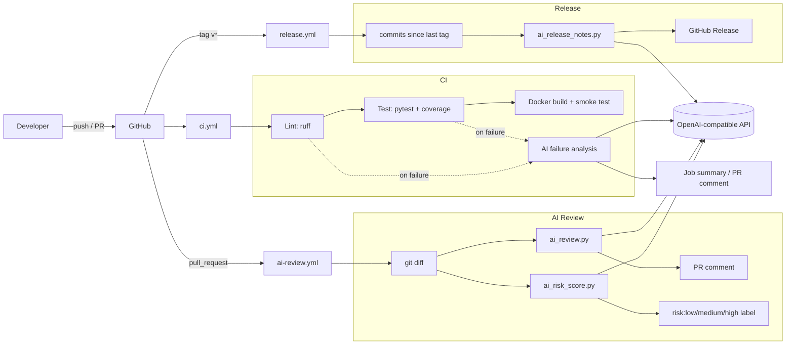

# AI-Powered CI/CD Pipeline

[](https://github.com/shubhamkhedkar/ai-powered-cicd-pipeline/actions/workflows/ci.yml)

A GitHub Actions pipeline that adds AI to the CI/CD loop: **AI code review**, **PR risk scoring**, **CI failure analysis**, and **AI release notes**. All of it runs on a small sample Flask API. It works with any **OpenAI-compatible** API (OpenAI, Azure OpenAI, Groq, Together, Ollama, and others). If no API key is set, every AI step is **skipped** and the pipeline still passes.

## Architecture



## AI stages

| Stage | Script | Trigger | Output |
|---|---|---|---|
| Code review | `scripts/ai/ai_review.py` | `pull_request` | PR comment + job summary |
| Risk score | `scripts/ai/ai_risk_score.py` | `pull_request` | `risk:low` / `risk:medium` / `risk:high` label |
| Failure analysis | `scripts/ai/ai_failure_analysis.py` | CI lint/test failure | Root cause + suggested fix in the job summary (and a PR comment) |
| Release notes | `scripts/ai/ai_release_notes.py` | tag `v*` push | GitHub Release body (falls back to a plain commit list without a key) |

- **Review:** sends the PR's unified diff (capped at 60k characters) with a reviewer prompt. The model's markdown reply is posted as a PR comment.
- **Risk score:** asks the model for JSON `{"risk", "reason"}` and parses it defensively (defaulting to `medium`). The result is applied as a label.
- **Failure analysis:** the CI job tees `ruff`/`pytest` output to logs and uploads them as an artifact. A follow-up job runs only `if: failure()`, downloads the logs, and asks the model for the root cause and a fix.
- **Release notes:** collects `git log <prev-tag>..<tag>` and asks the model to group the commits into Features, Fixes, and Maintenance. `gh release create` then publishes the release.

The scripts use only the Python standard library (`urllib`), so the AI jobs don't need to install anything.

### Permissions (least privilege)
- `ci.yml`: `contents: read`. Only the failure-analysis job gets `pull-requests: write`.
- `ai-review.yml`: `contents: read`, `pull-requests: write`.
- `release.yml`: `contents: write` (needed to create the release).
- Nothing is deployed to any cloud.

> Note: on PRs from forks, GitHub doesn't pass secrets or write tokens to `pull_request` workflows. The AI steps therefore skip, or only warn, on fork PRs.

## Setup

1. Fork or clone this repo.
2. Go to **Settings → Secrets and variables → Actions → New repository secret** and add `AI_API_KEY`.
3. Optionally, add these repository **variables**:
   - `AI_BASE_URL` (default `https://api.openai.com/v1`)
   - `AI_MODEL` (default `gpt-4o-mini`)
4. Open a PR to see the review comment and risk label. Push a tag (`git tag v0.1.0 && git push --tags`) to get a release.

## Running locally

```bash
python -m venv .venv && source .venv/bin/activate
pip install -r requirements-dev.txt
ruff check . && ruff format --check .
pytest --cov=app --cov=scripts
python -m app.main                     # API on :8000
docker build -t ai-cicd-sample . && docker run -p 8000:8000 ai-cicd-sample

# AI scripts (they skip gracefully without a key)
export AI_API_KEY=sk-...
git diff main > pr.diff && python scripts/ai/ai_review.py --diff-file pr.diff --no-comment
python scripts/ai/ai_failure_analysis.py pytest.log
python scripts/ai/ai_release_notes.py --tag HEAD
```

API: `GET /health`, `GET /items`, `POST /items {"name": "..."}`, `GET /items/<id>`.

## Cost notes

- With `gpt-4o-mini`, a typical PR review (5–20k input tokens) costs well under **$0.01**. Each PR push runs both review and risk scoring, so that's two calls.
- Inputs are capped at about 60k characters and logs are tail-truncated, which keeps the worst case bounded.
- Failure analysis runs only when CI fails. Release notes run once per tag.
- `concurrency` cancels superseded review runs. To skip reviews on drafts, the review job checks `draft == false`.
- To pay nothing, leave `AI_API_KEY` unset or point `AI_BASE_URL` at a local Ollama/vLLM server.

## License

MIT
